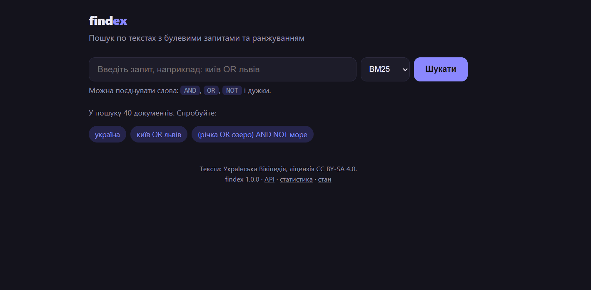
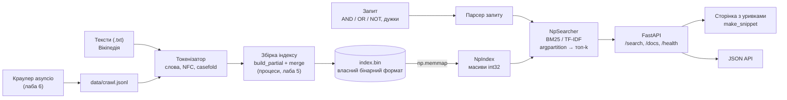

# findex

[](https://github.com/woikaaa/findex/actions/workflows/ci.yml)

**findex — це пошукова система на Python для україномовних текстів: вона будує індекс, шукає з ранжуванням (BM25) і працює як сайт.**

**Живий сервіс: <https://findex-l029.onrender.com>** (безкоштовний тариф Render: без запитів
сервіс засинає, перший запит після сну може чекати до хвилини).



Відео-огляд (2–3 хв): **[дивитись на Google Диску](https://drive.google.com/file/d/1-kZfZNQpGYydarxHb-ZdBP3nQB4Dls3v/view?usp=sharing)**

## Три головні числа

| Число    | Що означає                                                                                               |
| -------- | -------------------------------------------------------------------------------------------------------- |
| **6,9×** | швидше шукає частотне слово масивами NumPy, ніж звичайний код (0,2275 → 0,0330 мс, корпус із 170 статей) |
| **2,2×** | швидше будується сторінка результатів з уривками (103,5 → 47,6 мс) після профілювання                    |
| **−35%** | менше пам'яті (35,0 → 22,8 МБ), якщо індекс читати через `memmap` замість списків Python                 |

## Як рухаються дані



## Швидкий старт

Потрібен Python 3.11 або новіший.

```bash
python -m venv .venv
.venv\Scripts\activate          # Windows (PowerShell)
pip install -e .
findex index demo/corpus -o demo/index.bin
findex search "київ OR львів" -i demo/index.bin -k 3
findex serve --port 8000        # сайт: http://127.0.0.1:8000
```

Корпус для дослідів (40 статей української Вікіпедії): `python get_wiki.py`.
Більший корпус для вимірювань лаби 8: `python get_wiki_big.py --docs 170`.

Перевірки (їх же запускає CI): `ruff check .`, `ruff format --check .`, `pyright`, `pytest --cov`.
Бенчмарки: `pytest benchmarks --benchmark-only`.

## Що я зробила в кожній лабі

Кожна лаба має тег (`lab-01` … `lab-08`, остаточна версія `v1.0.0`).
Повні описи, команди й виміри: [docs/labs.md](docs/labs.md).

### Лаба 1: читаю тексти по одному (генератори)

| Версія              | Документів | Слів    | Пам'ять    | Час    |
| ------------------- | ---------- | ------- | ---------- | ------ |
| жадібна (списки)    | 40         | 268 667 | 29 363 KiB | 0,96 с |
| ледача (генератори) | 40         | 268 667 | 9 075 KiB  | 1,07 с |

Ледача версія тримає один документ замість всіх: пам'яті в 3,2 раза менше, час майже той самий.

### Лаба 2: індекс і пошук AND / OR / NOT

| Спосіб зберігання    | Пам'ять при побудові |
| -------------------- | -------------------- |
| звичайний dataclass  | 25,9 МБ              |
| dataclass зі `slots` | **21,0 МБ**          |
| пари `array('I')`    | 23,3 МБ              |

| Формат           | Розмір         | Збереження | Завантаження |
| ---------------- | -------------- | ---------- | ------------ |
| pickle           | 3 106 461 байт | 0,618 с    | 1,474 с      |
| власний бінарний | 2 828 458 байт | 0,063 с    | 0,812 с      |

### Лаба 3: ранжування (BM25, TF-IDF), фрази, уривки

Точність першої п'ятірки (precision@5) на моїх 10 запитах: середнє **0,36** і в TF-IDF, і в BM25 (корпус маленький,
різниці не видно). Три перевірки формули: рідкісне слово важить більше за часте (3,478 проти 0,013),
повторення додають все менше (1,419 → 0,0238), короткий документ вище за довгий (5,709 проти 1,469).

### Лаба 4: типи, тести, пакування, CLI

| Було                                     | Стало                                           |
| ---------------------------------------- | ----------------------------------------------- |
| `python -m findex.index data/ ...`       | `findex index data/ ...`                        |
| `python -m findex.ranking index.bin "q"` | `findex search "q" -i index.bin`                |
| скрипти з `assert`                       | `pytest` (93 тести, покриття 79% на той момент) |

`pyright` у режимі `strict`: 0 помилок. CI запускає ruff, pyright і pytest на Python 3.11, 3.12, 3.13.

### Лаба 5: конкурентність і GIL (800 файлів, `--storage array`)

| Виконавець | Воркерів | Час, с | Прискорення |
| ---------- | -------- | ------ | ----------- |
| serial     | 1        | 7,51   | 1,00×       |
| threads    | 4        | 8,41   | 0,89×       |
| threads    | 16       | 9,76   | 0,77×       |
| processes  | 4        | 2,82   | 2,66×       |
| processes  | 8        | 2,55   | **2,94×**   |
| processes  | 16       | 4,02   | 1,87×       |

Потоки не прискорюють через GIL, процеси прискорюють. На Python 3.13t (без GIL) потоки теж прискорили: 3,15× на 8 потоках.

### Лаба 6: асинхронний краулер (мій демо-сайт, `max_pages = 200`)

| concurrency | Час, с | Сторінок/с | Помилок |
| ----------- | ------ | ---------- | ------- |
| 1           | 13,06  | 15,3       | 0       |
| 5           | 4,02   | 49,9       | 0       |
| 20          | 2,29   | 87,9       | 0       |

Краулер чекає мережу, а не рахує, тому одного потоку з `asyncio` досить. Він читає `robots.txt`, повторює лише 429/5xx/таймаут
з backoff і уміє читати `Retry-After`.

### Лаба 7: пошук у вебі (FastAPI, Docker, Render), навантаження `oha`, 20 з'єднань

| Що міряю                    | Запитів/с | p50    |
| --------------------------- | --------- | ------ |
| 1 воркер, `def` (Windows)   | 7,80      | 2,68 с |
| 1 воркер, `def` (Docker)    | 8,34      | 2,53 с |
| 4 воркери, `def` (Docker)   | 26,62     | 0,15 с |
| Render (безкоштовний тариф) | 1,44      | 18,1 с |

Кілька процесів дали 3,2× (в кожного свій GIL). Повільний Render це межа безкоштовного тарифу.

### Лаба 8: профілювання, NumPy, `memmap`, версія 1.0.0

| Випадок         | Лаба 3, мс | NumPy, мс | Прискорення |
| --------------- | ---------- | --------- | ----------- |
| частий (`на`)   | 0,2275     | 0,0330    | 6,9×        |
| рідкісний (`𝕂`) | 0,0058     | 0,0178    | 0,3×        |
| три слова       | 0,4614     | 0,0619    | 7,5×        |

Сторінка з уривками: 103,5 → 47,6 мс. Пам'ять: списки 35,0 МБ, NumPy 23,9 МБ, `memmap` 22,8 МБ.
Профілі, гіпотези і пояснення, чому на малому корпусі виграш скромний: [docs/profiling.md](docs/profiling.md).

## Обмеження

- **Шукає точні форми слів.** «козаки» не знайде «козак»: стемінгу чи лематизації немає.
- **Фрази в лапках у швидкому (NumPy) пошуку не працюють**, бо NumPy-індекс не зберігає позицій слів.
  Фрази є лише в повільному пошуку лаб 2–3 з індексом `--positions`.
- **Лише BM25 і TF-IDF.** Семантичного пошуку (за змістом) немає, замість нього я виміряла `memmap`.
- **Корпус маленький:** 40 статей на сайті, 170 для вимірів лаби 8. На великих даних (мільйони документів)
  я не перевіряла. `memmap` виміряно лише на індексі в 3,6 МБ, там різниця з NumPy мала.
- **Рідкісні слова NumPy шукає повільніше** за звичайний цикл (різниця ~0,012 мс).
- **Живий сервіс повільний і засинає:** безкоштовний тариф Render дає мало процесора, при 20 одночасних запитах
  частина відповідей це 502.
- **На Windows `findex serve --workers N` у моєму середовищі не стартує** (помилка сокета `WinError 10022`).
  Кілька воркерів перевірено в Docker.
- Найдорожче на сторінці тепер це уривки (`make_snippet` проходить по тексту статті), а не сам пошук.
