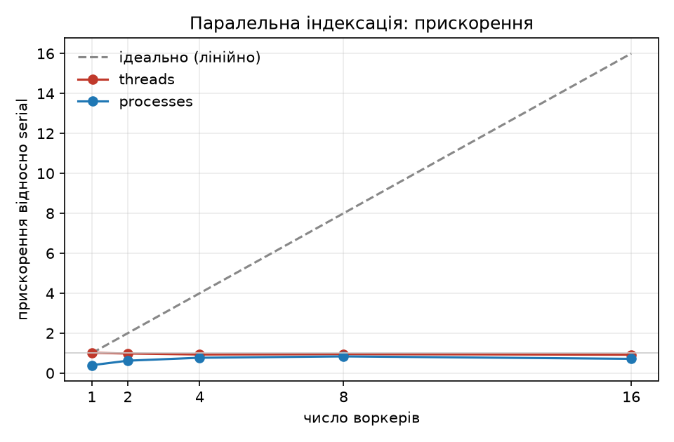

# findex

[](https://github.com/woikaaa/findex/actions/workflows/ci.yml)

Моя маленька пошукова система. Будую її по частинах на курсі «Python».
Тут шість лабораторних, у кожної свій тег: `lab-01` … `lab-06`.

## Корпус

40 статей української Вікіпедії (міста, письменники, наука, інформатика), разом
близько 3,5 МБ. Папка `data/` не в git. Щоб скачати тексти:

```bash
python get_wiki.py
```

Тести працюють на маленькому наборі в `tests/fixtures/`.

## Встановлення і запуск

Потрібен Python 3.11 або новіший.

```bash
python -m venv .venv
.venv\Scripts\activate          # Windows (PowerShell)
pip install -e .                 # сам findex і те, що йому потрібно
pip install pytest pytest-cov hypothesis ruff pyright matplotlib psutil   # інструменти для розробки
findex --help
```

Перевірки (їх же запускає CI на GitHub):

```bash
ruff check .
ruff format --check .
pyright
pytest --cov
```

## Файли

| Файл                       | Лаба | Що робить                                     |
| -------------------------- | ---- | --------------------------------------------- |
| `corpus.py`                | 1    | читає документи по одному                     |
| `tokenize.py`              | 1    | ділить текст на слова                         |
| `stats.py`                 | 1    | рахує статистику корпусу                      |
| `model.py`, `index.py`     | 2    | будують індекс                                |
| `search.py`                | 2    | пошук AND / OR / NOT                          |
| `store.py`                 | 2    | зберігає й завантажує індекс                  |
| `bench.py`, `memstudy.py`  | 2    | виміри швидкості й пам'яті                    |
| `query.py`                 | 3    | розуміє запити з дужками й фразами            |
| `scoring.py`, `ranking.py` | 3    | ставить результати за порядком (BM25, TF-IDF) |
| `snippets.py`, `utils.py`  | 3    | уривки тексту, таймер `@timed`                |
| `sanity.py`, `evaluate.py` | 3    | перевірки та precision@5                      |
| `cli.py`, `__main__.py`    | 4    | команда `findex` (index, search, stats)       |
| `parallel.py`              | 5    | паралельна збірка індексу (потоки, процеси)   |
| `bench_parallel.py`, `plotting.py` | 5 | виміри прискорення і графік            |
| `race_demo.py`             | 5    | демонстрація гонитви потоків                  |

---

# Лаба 1: читаю тексти по одному

**Мета.** Не тримати весь корпус у пам'яті, а читати документи й слова по одному
(через генератори). Порахувати документи, слова й найчастіші слова.

**Команди:**

```bash
findex stats data/            # ледача версія
findex stats data/ --eager    # жадібна версія (для порівняння)
```

## Правила токенізатора

- Текст нормалізується (NFC), літери робляться малими (`casefold`).
- Апостроф і дефіс всередині слова залишаються (`п'ять`, `well-known`).
- Цифри стають окремими словами.
- Знак наголосу видаляється, щоб «Архітекту́ра» не розпадалась на два слова.

## Результат

| Версія              | Документів | Слів    | Пам'ять    | Час    |
| ------------------- | ---------- | ------- | ---------- | ------ |
| жадібна (списки)    | 40         | 268 667 | 29 363 KiB | 0,96 с |
| ледача (генератори) | 40         | 268 667 | 9 075 KiB  | 1,07 с |

**Куди пішла пам'ять.** Жадібна версія тримає все одразу: усі тексти, списки слів
і один великий список усіх слів. Ледача тримає тільки один документ і лічильник
слів. Тому пам'яті треба в 3,2 раза менше, а час майже однаковий. Різниця не
більша, бо лічильник 56 144 різних слів потрібен в обох версіях.

---

# Лаба 2: індекс для швидкого пошуку

**Мета.** Зробити індекс: для кожного слова запам'ятати, в яких документах воно є.
Тоді пошук не читає всі тексти. Реалізувати пошук AND / OR / NOT, зберегти індекс
у файл і порівняти способи зберігання.

**Команди:**

```bash
findex index data/ --out index.bin --format pickle
findex index data/ --out index.fbin --format binary
python -m findex.memstudy data/
python -m findex.bench index.fbin
```

У індексі 56 144 слова і 119 964 записи (в середньому 2,14 запису на слово).

## Пам'ять: три способи зберігання

| Спосіб               | Пам'ять при побудові | Файл pickle |
| -------------------- | -------------------- | ----------- |
| звичайний dataclass  | 25,9 МБ              | 3,83 МБ     |
| dataclass зі `slots` | **21,0 МБ**          | 3,11 МБ     |
| пари `array('I')`    | 23,3 МБ              | 3,99 МБ     |

**Куди пішли байти.** Звичайний об'єкт займає найбільше, бо має свій словник
атрибутів. `slots` його прибирає, тому економить пам'ять. Я думала, що `array`
буде найкращим, але на моєму корпусі слів багато, а записів на слово мало (2,14).
Для кожного слова створюється окремий масив, і ці витрати з'їдають економію.

Позиції слів (`--positions`) додають пам'яті: +59% (dataclass) і +73% (`slots`).

## Збереження і завантаження

| Формат           | Розмір         | Збереження | Завантаження |
| ---------------- | -------------- | ---------- | ------------ |
| pickle           | 3 106 461 байт | 0,618 с    | 1,474 с      |
| власний бінарний | 2 828 458 байт | 0,063 с    | 0,812 с      |

`pickle` небезпечний: при завантаженні чужого файлу може виконатись чужий код.
Тому я завантажую тільки свої файли. Бінарний формат безпечний.

## merge проти set (час пошуку AND)

Найчастіші слова: `а`, `або` (по 40 документів). Найрідші: `茶`, `阿部重雄著` (по 1).

| Випадок                 | merge   | set     |
| ----------------------- | ------- | ------- |
| частий AND частий       | 5,5 мкс | 3,5 мкс |
| рідкісний AND рідкісний | 0,3 мкс | 0,5 мкс |
| частий AND рідкісний    | 3,7 мкс | 1,4 мкс |

`set` швидший на частих словах, бо працює на швидкій мові C. Списки короткі, тому
різниця у мікросекундах.

---

# Лаба 3: ранжування і складні запити

**Мета.** Показувати найкращі результати зверху (формули BM25 і TF-IDF),
розуміти запити з дужками та фразами в лапках, показувати уривки тексту.

**Команди:**

```bash
findex index data/ --out index.bin --positions
findex search "київ OR львів" -i index.bin -k 3
findex -v search "київ OR львів" -i index.bin -k 3
python -m findex.sanity index.bin
python -m findex.evaluate index.bin queries.json
```

Запити: `a b` (AND), `AND`, `OR`, `NOT`, дужки, `"точна фраза"`.
Оператори пишуться великими літерами.

## Три перевірки ранжування

1. **Рідкісне слово важить більше за часте:** 3,478 проти 0,013.
2. **Повторення додають все менше:** друге входження додає 1,419, а 21-ше лише 0,0238.
3. **Короткий документ вище за довгий** (одне входження): 5,709 проти 1,469.

## Таймер і кеш

```
[findex.timing] Searcher.search took 0.34 ms
[findex.search] cache hit for 'київ OR львів'
[findex.timing] Searcher.search took 0.41 ms
```

Рядок `cache hit` показує, що кеш спрацював. Швидше не стало: кеш запам'ятовує
тільки знаходження документів, а на малому корпусі різниця непомітна.

## precision@5 (10 моїх запитів)

| Запит                          | TF-IDF   | BM25     |
| ------------------------------ | -------- | -------- |
| поет вірші збірка              | 0,80     | 0,80     |
| алгоритм структура дані        | 0,40     | 0,40     |
| нейронна мережа навчання       | 0,40     | 0,40     |
| планета зірка Сонце            | 0,40     | 0,40     |
| шахова партія фігури           | 0,20     | 0,20     |
| кавові зерна напій             | 0,40     | 0,40     |
| козаки гетьман Січ             | 0,40     | 0,40     |
| футбольний клуб чемпіонат      | 0,20     | 0,20     |
| операційна система ядро процес | 0,20     | 0,20     |
| пошукова система індекс        | 0,20     | 0,20     |
| **середнє**                    | **0,36** | **0,36** |

Обидві формули дали однаковий результат. Корпус маленький, тому різниці не видно.
Пошук шукає точні форми слів («козаки» не знайде «козак»).


---

# Лаба 4: типи, тести, пакування і CLI

**Мета.** Зробити з набору скриптів справжній пакет: типи без помилок, тести,
встановлення однією командою і CI, який перевіряє все на кожен пуш.

**Команди:**

```bash
findex index data/ -o index.bin                 # будує й зберігає індекс
findex index data/ -o index.pkl --positions     # з позиціями (для фраз, формат pickle)
findex search "київ OR львів" -i index.bin -k 5 # таблиця rich
findex search "київ" -i index.bin --json        # JSON у stdout
findex stats data/ --top 10
findex -vv search ...                           # логи DEBUG у stderr
```

Таблиця і прогрес друкуються через `rich`, повідомлення і помилки йдуть у stderr,
результат у stdout. При помилці (немає файлу, поганий запит) — один рядок
українською і код виходу 2, без стека.

## Типи

- `pyright` у режимі `strict` для всього `src/`: 0 помилок, 0 попереджень.
- `Protocol`: `Scorer` (оцінювач) і `PostingLike` (запис у списку). `Posting` і
  `PlainPosting` підходять під нього без успадкування.
- `Literal` для значень, яких кілька: `Storage`, `Engine`, `ScorerName`, `Fmt`.
  `typer` сам перевіряє їх у командному рядку.
- `@timed` типізований через `ParamSpec` і `TypeVar`, тому не губить підпис функції.

## Тести

```bash
pytest --cov
```

- на момент лаби 4 було 93 тести: токенізатор, індекс, злиття частин, пошук і парсер, ранжування, збереження,
  CLI (через `CliRunner`).
- 6 властивостей через Hypothesis: `load(save(index))` дає той самий індекс, постінги
  завжди відсортовані, merge = операції над set, токенізація ідемпотентна тощо.
- Покриття на момент лаби 4: **79%** (рядки і гілки). Не покрито: `bench.py`, `memstudy.py`,
  `evaluate.py`, `sanity.py` — це скрипти для вимірів з власним `main()`, які
  працюють з повним корпусом `data/`; вони не входять у тести, бо їх результат
  це числа в README, а не правильна/неправильна відповідь.

## CI і випуск

`.github/workflows/ci.yml` на кожен пуш і pull request запускає ruff, pyright і
pytest на Python 3.11, 3.12 і 3.13. Версія `0.4.0`; у релізі на GitHub лежить
файл `findex-0.4.0-py3-none-any.whl` (збирається командою `python -m build --wheel`).

## Що змінилось після лаби 3

| Було                                         | Стало                              |
| -------------------------------------------- | ---------------------------------- |
| `python -m findex.index data/ ...`           | `findex index data/ ...`           |
| `python -m findex.ranking index.bin "q"`     | `findex search "q" -i index.bin`   |
| `python -m findex.stats data/`               | `findex stats data/`               |
| `python tests/test_*.py` з assert            | `pytest` (фікстури, parametrize)   |

---

# Лаба 5: конкурентність і GIL

**Мета.** Виміряти, що дають кілька ядер для побудови індексу: потоки, процеси і
Python 3.13t без GIL.

## Як це влаштовано

`build_index` поділено на дві частини: `build_partial(paths, first_doc_id, ...)`
будує частину індексу з кількох файлів, а `merge(partials)` склеює частини.
`build_partial` — функція верхнього рівня, тому її можна віддати іншому процесу.
У воркер їдуть **лише шляхи** до файлів, а не прочитані тексти. Кожен шматок
одразу отримує свій діапазон `doc_id` (шматки йдуть підряд і їх розміри в байтах
приблизно однакові), тому номери документів унікальні на весь корпус.

Послідовний варіант `merge([build_partial(усі файли)])` дає той самий індекс, що й
у лабі 4 (окремий тест `test_sequential_partial_merge_equals_build_index`).

```bash
findex index data/ -o index.bin --executor serial
findex index data/ -o index.bin --executor threads --workers 4
findex index data/ -o index.bin --executor processes --workers 4
```

Процеси запускаються методом `spawn` (однаково на Windows, macOS і Linux). Якщо
воркер упав, `findex index` одразу падає і показує його помилку, а не висить.

## Вимірювання

```bash
pip install matplotlib psutil                    # якщо ще не встановлено
python -m findex.bench_parallel run data/ --repeats 3
```

Скрипт міряє виконавців `threads` і `processes` для 1, 2, 4, 8 і `os.cpu_count()`
воркерів (плюс рядок `serial`). Кожна клітинка рахується в окремому процесі Python,
щонайменше 3 рази, у таблицю йде медіана. Результат лежить у `docs/bench.md`,
`docs/bench.json` і `docs/speedup.png`.

- wall — скільки пройшло за годинником; CPU — сума процесорного часу воркерів і
  `merge`; RSS — пік пам'яті батьківського процесу; прискорення = wall(serial) / wall.

**Машина:** Intel Core i7-12650H, 16 логічних потоків (`os.cpu_count()` = 16; фізичних ядер 10), Python 3.13.1 (GIL увімкнено).

**Основна таблиця: 800 файлів, `--storage array`** (`docs/big_array/bench.md`, медіана з 3 запусків):

| виконавець | воркерів | wall, с | CPU, с | merge, с | RSS батька, МБ | прискорення |
| ---------- | -------- | ------- | ------ | -------- | -------------- | ----------- |
| serial | 1 | 7.51 | 7.45 | 0.01 | 74 | 1.00× |
| threads | 1 | 7.50 | 7.47 | 0.01 | 74 | 1.00× |
| threads | 2 | 8.01 | 8.08 | 0.04 | 105 | 0.94× |
| threads | 4 | 8.41 | 8.41 | 0.09 | 144 | 0.89× |
| threads | 8 | 8.85 | 8.92 | 0.19 | 224 | 0.85× |
| threads | 16 | 9.76 | 9.94 | 0.37 | 376 | 0.77× |
| processes | 1 | 8.00 | 7.48 | 0.01 | 122 | 0.94× |
| processes | 2 | 4.39 | 7.59 | 0.04 | 123 | 1.71× |
| processes | 4 | 2.82 | 7.94 | 0.09 | 159 | 2.66× |
| processes | 8 | 2.55 | 10.11 | 0.19 | 241 | 2.94× |
| processes | 16 | 4.02 | 17.23 | 0.40 | 402 | 1.87× |

З потоками стає гірше (7.50 → 9.76 с). З процесами найкраще 8 воркерів: 2.55 с, прискорення 2.94×.
На 16 воркерах гірше (4.02 с): фізичних ядер лише 10, процеси заважають одне одному, CPU-час виріс до 17.23 с.

**800 файлів, `--storage slots`** (`docs/big/bench.md`), процеси програють через pickle:

| виконавець | воркерів | wall, с | CPU, с | merge, с | RSS батька, МБ | прискорення |
| ---------- | -------- | ------- | ------ | -------- | -------------- | ----------- |
| serial | 1 | 11.70 | 11.59 | 0.01 | 207 | 1.00× |
| threads | 1 | 11.44 | 11.36 | 0.01 | 209 | 1.02× |
| threads | 2 | 12.58 | 12.55 | 0.06 | 231 | 0.93× |
| threads | 4 | 13.86 | 13.88 | 0.14 | 262 | 0.84× |
| threads | 8 | 14.03 | 13.83 | 0.25 | 300 | 0.83× |
| threads | 16 | 14.94 | 15.09 | 0.45 | 386 | 0.78× |
| processes | 1 | 28.37 | 11.34 | 0.01 | 646 | 0.41× |
| processes | 2 | 18.12 | 11.17 | 0.06 | 458 | 0.65× |
| processes | 4 | 13.37 | 12.25 | 0.14 | 382 | 0.88× |
| processes | 8 | 12.94 | 14.84 | 0.23 | 395 | 0.90× |
| processes | 16 | 13.88 | 24.94 | 0.40 | 466 | 0.84× |

**Малий корпус, 40 файлів** (`docs/bench.md`), запуск процесів дорожчий за саму роботу:

| виконавець | воркерів | wall, с | CPU, с | merge, с | RSS батька, МБ | прискорення |
| ---------- | -------- | ------- | ------ | -------- | -------------- | ----------- |
| serial | 1 | 0.60 | 0.58 | 0.01 | 44 | 1.00× |
| threads | 1 | 0.59 | 0.58 | 0.01 | 44 | 1.01× |
| threads | 2 | 0.61 | 0.62 | 0.02 | 47 | 0.98× |
| threads | 4 | 0.65 | 0.66 | 0.02 | 49 | 0.93× |
| threads | 8 | 0.64 | 0.62 | 0.03 | 52 | 0.95× |
| threads | 16 | 0.65 | 0.67 | 0.03 | 54 | 0.92× |
| processes | 1 | 1.52 | 0.61 | 0.01 | 63 | 0.40× |
| processes | 2 | 0.97 | 0.59 | 0.02 | 56 | 0.62× |
| processes | 4 | 0.78 | 0.59 | 0.03 | 54 | 0.77× |
| processes | 8 | 0.72 | 0.70 | 0.03 | 55 | 0.84× |
| processes | 16 | 0.84 | 1.11 | 0.03 | 56 | 0.71× |



Пряма пунктирна лінія — ідеальне лінійне зростання.

## Python 3.13t без GIL

Збірку 3.13t ставить інструмент `uv` (тільки для цього досліду; решта проєкту
працює через звичайні `venv` і `pip`):

```bash
pip install uv
uv python install 3.13t
uv venv --python 3.13t .venv313t
.venv313t\Scripts\activate
uv pip install -e .      # саме uv pip, бо звичайний pip тут бере pip зі старого .venv
python -c "import sys; print(sys._is_gil_enabled())"      # False
python -m findex.race_demo
findex index data/ -o index.bin --executor threads --workers 4
```

Час міряю так: `Measure-Command { findex index data/ -o index.bin --executor threads --workers 4 }`
(і так само для `--executor serial`, `--workers 1, 2, 4`).

| Python | serial | threads 1 | threads 2 | threads 4 | threads 8 |
| ------ | ------ | --------- | --------- | --------- | --------- |
| 3.13t, без GIL | 8.79 с | 8.86 с (0.99×) | 4.97 с (1.77×) | 3.14 с (2.80×) | 2.79 с (3.15×) |
| 3.13.1, з GIL | 8.05 с | 8.12 с (0.99×) | 8.62 с (0.93×) | 9.18 с (0.88×) | 9.45 с (0.85×) |

Це час усієї команди `findex index data_big/ --storage array` (разом із запуском
програми і записом файлу), медіана з 3 запусків; у дужках прискорення відносно
`serial` на тій самій збірці Python.

Python 3.13.1 (з GIL): `python -m findex.race_demo`, 4 потоки по 200 000 оновлень, очікуємо 800 000.
Втрачено оновлень за 3 запуски: без Lock `[0, 0, 0]`, з Lock `[0, 0, 0]`.

Python 3.13.17t (`sys._is_gil_enabled()` = False), так само 4 потоки по 200 000:

| лічильник | без Lock (втрачено за 3 запуски) | з Lock |
| --------- | -------------------------------- | ------ |
| int | `[437667, 508311, 508729]` | `[0, 0, 0]` |
| Counter | `[499411, 494444, 492466]` | `[0, 0, 0]` |

## Сторінка про GIL

Докладно своїми словами: [docs/gil.md](docs/gil.md) (чому потоки не прискорили,
чому процеси прискорили і чим це оплачено, закон Амдала, 3.13t, гонитва і Lock).

## Який виконавець типовий

Правило в `findex index`, коли `--executor` не вказано:

- `--storage array` (без `--positions`): **processes**, 4 воркери. У цьому режимі частина
  індексу — це компактні масиви, pickle швидкий, і процеси виграють;
- `--storage slots` (типове сховище) і `--positions`: **serial**. Там частина індексу
  складається з мільйонів окремих об'єктів, pickle занадто повільний, і процеси програють.

Мої виміри (800 файлів):

- `slots`: одна частина індексу після `pickle.dumps` займає **37.3 МБ**, `dumps` 10.28 с, `loads` 13.63 с.
  Це більше, ніж сама індексація на одному ядрі, тому процеси не виграють (найкраще 0.90×).
- `array`: окремо pickle не міряла, але `processes 1` (8.00 с) лише на 0.5 с повільніший
  за `serial` (7.51 с), тобто запуск процесу і pickle коштують мало. Тому процеси дають 2.94×.

